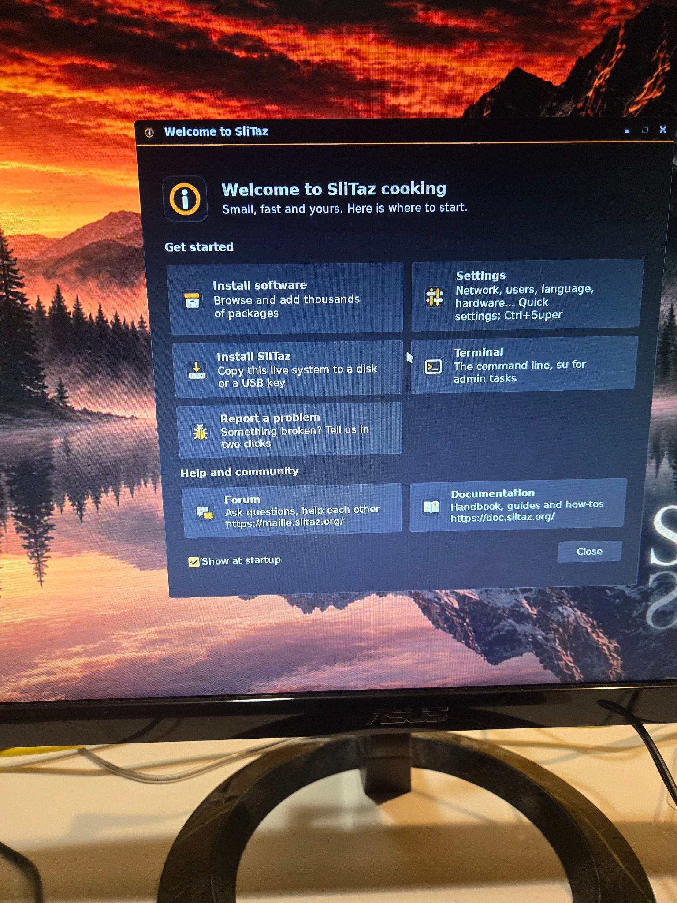
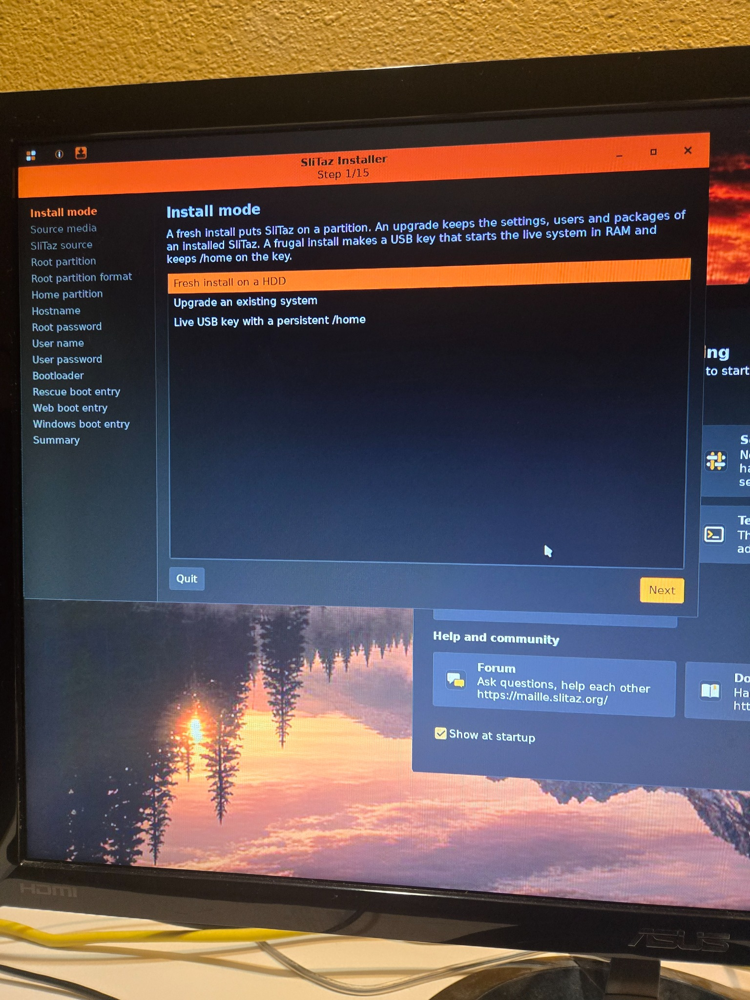
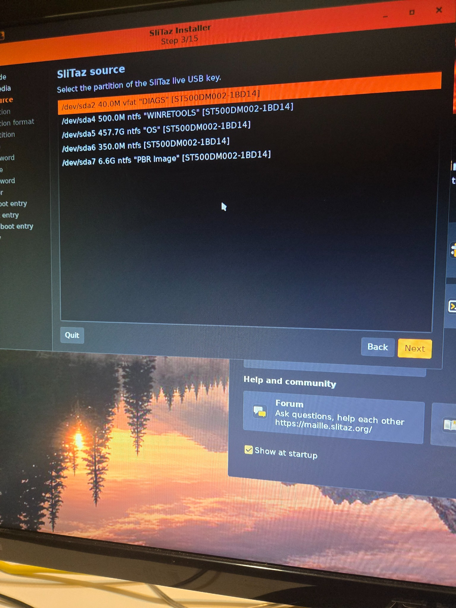
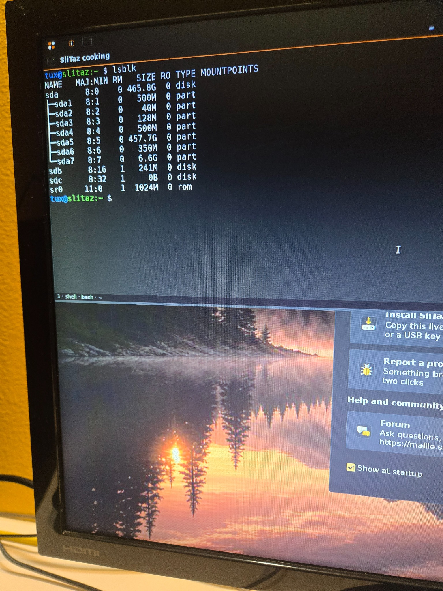
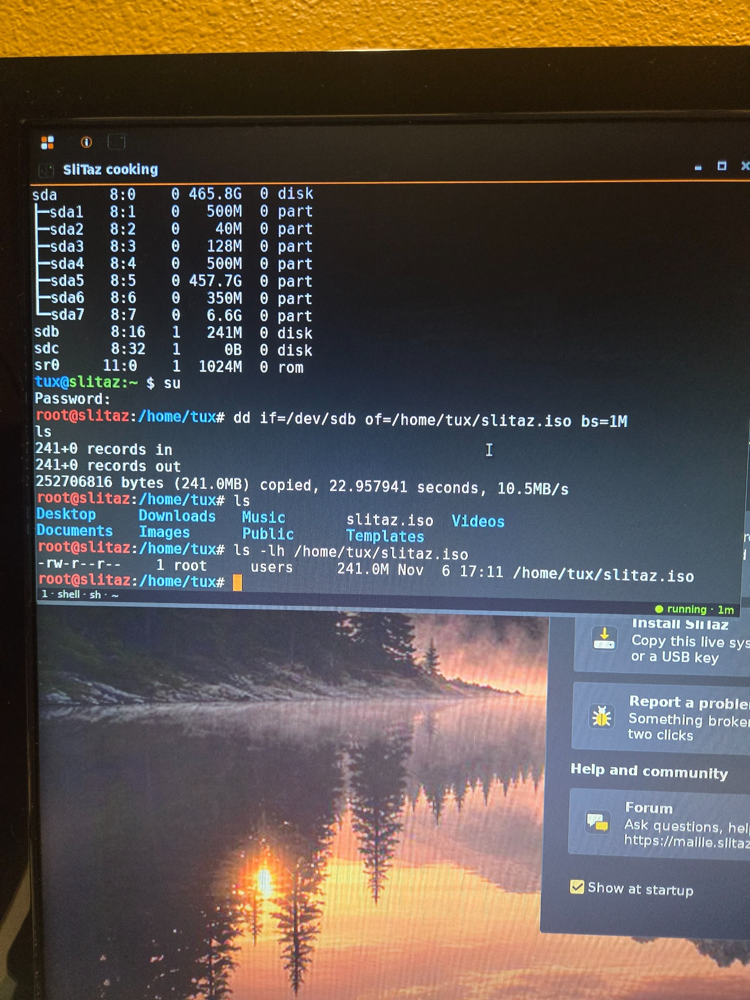
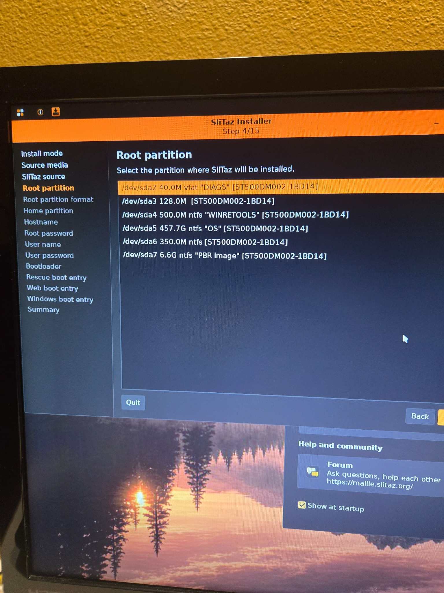

November 8 2026

CONVERSION PROCESS

This log details the steps I took to changing the old PC to a slitaz PC

1. Converted an old small USB to a Bootable device with Slitaz on it
2. Booted up the old PC and spam press F2

3. Adjusted the following settings in Boot Screen
- Secure Boot Control: Disabled
- Boot Mode: Legacy
- USB Boot Support: Enabled
- Boot priority: USB Storage Device first

4. Saved and rebooted the PC to reach USB boot on slitaz
5. I initially tried to test if non-cable wifi connectivity still worked on this OS but nothing was successful. I will work on this later
 

6. Clicked Install to begin putting Slitaz onto the PC proper.

7. Clicked Fresh install on an HDD

- At this point I ran into an issue where I did not see the USB to grab as the Slitaz Source for the download.
- I needed to troubleshoot, and ended up needing to open up the terminal to ensure the USB was being read.

- It was here that I saw that the USB was marked as 'sdb' and had no directory/path for the PC to 'find' it in a sense. I ended up asking chatgpt for assistance here,
- I found that there was a way to rectify this; which was to first login to root level with :
- "su"
- password="root"
- then I ran this code, which read the USB and created a reachable ISO copy to begin the download;
- "dd if=/dev/sdb of=/home/tux/slitaz.iso bs=1M"

After checking that this all worked, I went back to install to check the Slitaz Source page, and saw an option to select "/home/tux/slitaz.iso" so I was all set to continue.

8. The partition to place the ISO was "/dev/sda5   457.7G   ntfs   "OS" " as it was the HDD of the original PC

9. Created my Hostname with Root Password, and a User name with User password.

10. The following 3 settings were left as their defaults;
- Bootloader: GRUB2.
- Rescue boot entry: default.
- Web boot entry: default.
- Windows boot entry: no

11. installation now completed.
